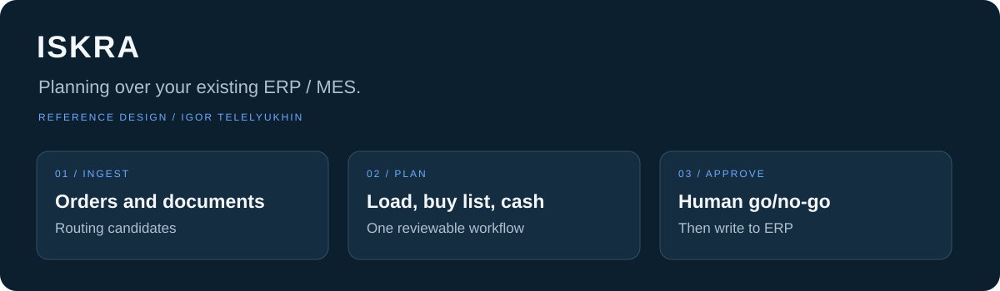
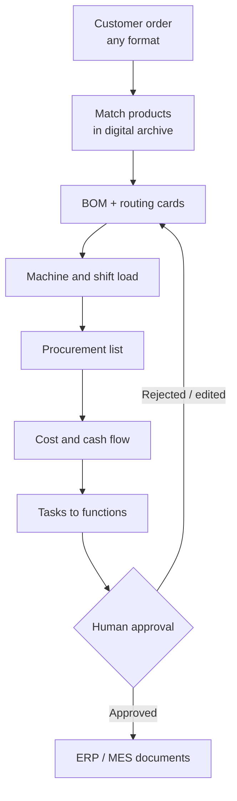

# Iskra — AI planning layer over ERP / MES

> AI-assisted production planning over your existing ERP/MES. A reference design showing how orders, engineering documents, machine capacity, procurement, and cash flow can be connected in one reviewable workflow.

**Cross-functional planning** · **Human approval gates** · **Works on top of existing ERP**

**Status:** `Reference design · Modelled outcomes · No customer production data`

[Overview](#for-plant-owners-30-seconds) · [Architecture](#for-technical-due-diligence) · [Reference case](docs/case-reference-plant.md) · [Data model](docs/data-model.md) · [Contact](#contact)

This repository is a **public showcase**: architecture intent, data-model sketches, and a reference-plant case with **calculated estimates**. It is not the production system. Production models, algorithms, and integrations are proprietary and available under contract.

---

## For plant owners (30 seconds)

### Typical planning frictions

On the reference model of a household-appliance plant, typical planning frictions include:

- One customer order takes **days in spreadsheets**, and any change means starting over.
- Drawings and routings live partly on paper and in the heads of **two or three process engineers**; if they leave, the know-how leaves with them.
- Bottleneck machines overload while others sit idle, and the overload is found out too late.
- Procurement reacts to shortages; the warehouse holds dead stock and missing parts at the same time.
- Roughly **one order in three** ships late, and the director often learns about the miss from the customer.
- A plant-wide status pack for leadership takes **about two days** to assemble by hand (reference-model estimate).

### What changes

An AI-assisted planning layer sits **on top of** the ERP (and MES where present). Accounting stays in the systems you already run. The layer reads orders and engineering documents, proposes routings, machine load, procurement, and cash-flow impact, then publishes **tasks for each function**. People approve; nothing reaches the shop floor without a human signature.

On a **reference model** of a household-appliance plant (310 staff, 38 product models), calculated estimates after six months of modelled operation include:

| Indicator | Before (estimate) | After (estimate) |
|-----------|-------------------|------------------|
| Order → approved plan | ~4 working days | ~1 working day |
| Draft plan machine time | ~32 person-hours | ~1 h 40 min |
| Orders shipped on time | 71% | 88% |
| Average order lead time | 34 working days | 27 working days |
| Design → shop transfer errors | baseline | −60% |
| Material inventory | baseline | −12% (dead stock −15%) |
| Time to prepare a new modification | baseline | −50% |
| Bottleneck (moulding) utilisation | 74% | 82% |
| Overtime hours | baseline | −30% |
| Leadership status pack | ~2 days manual | near-real-time |

**Disclaimer:** these figures are **calculated estimates on a reference plant model** — illustrative assumptions for discussion, not measured statistics of a real plant or results of a real deployment. They illustrate order-of-magnitude effect under stated assumptions. See [docs/case-reference-plant.md](docs/case-reference-plant.md).

### One flow

**Rule:** the system proposes; process engineers and managers decide. No approved routing — no release to the shop.

---

## For technical due diligence

### Architecture overview

Iskra is an **ensemble**, not a single model:

- **Document understanding** — drawings, scans, legacy routing sheets, and order paperwork become structured candidates (geometry cues, quantities, identifiers).
- **Planning reasoning** — draft BOMs, routing cards, norms, and plain-language explanations for reviewers.
- **Deterministic schedule optimisation** — machine and shift loading under changeovers, calendars, and priorities (mathematical optimisation; not “the neural net invents the timetable”).
- **Shop-floor assistants** — lightweight aids for fact capture and prompts to supervisors (optional).
- **Risk / lead-time signals** — early flags for overload, late parts, and cash gaps.
- **ERP / MES exchange bus** — read masters and stock; write back **documents and tasks**. The ERP core is not rewritten.

Sensitive domains (people, payroll) are designed to stay **on-premises**. Cloud components are optional and used only under an explicit data-policy decision.

Detail and diagrams: [docs/architecture.md](docs/architecture.md).

### Module boundaries (sellable building blocks)

| Module | Intent | Depends on |
|--------|--------|------------|
| **Digital archive + routing cards** | Ingest heterogeneous drawings/docs; propose BOM + routing; human-in-the-loop approval | ERP item masters (or pilot subset) |
| **Equipment load optimiser** | Feasible shift plans and bottleneck forecast from approved routings | Quality routings + equipment model |
| **End-to-end order economics** | Buy list, cost, margin, weekly cash view **before** release | Approved structure + stock/price inputs |
| **Leadership portfolio / Kanban** | One screen: order stages, risks, KPI strip, constrained Q&A on contour data | Statuses from ERP + upstream modules |

Each module has an explicit **in / out of box** boundary (what a pilot includes vs. what is custom). See architecture doc.

### Human-in-the-loop

- Every routing card and plan package has an **approval gate**.
- Reviewer edits can be retained as the plant's knowledge in a contract deployment; this repo does **not** ship training pipelines.
- Leadership Q&A answers only from contour data; missing data is stated as missing (no invented facts).

### Data flow (conceptual)

Order & documents → structure candidates → **approve** → schedule & procurement candidates → **approve** → ERP/MES documents → shop execution → fact back into ERP → portfolio view.

Open, generic schemas (evaluation only): [docs/data-model.md](docs/data-model.md), [`schemas/`](schemas/), [`examples/`](examples/).

### Boundary conditions and limits of applicability

**Fits well when**

- Discrete manufacturing with identifiable products, BOMs, and machine/work-centre calendars.
- An ERP (and optionally MES) already holds orders, stock, and item masters.
- Leadership accepts a **pilot on one product family** beside the manual plan before plant-wide rollout.

**Does not replace**

- Full PLM/PDM, enterprise BI, or shop-floor SCADA deep integration (beyond basic exchange).
- Automatic purchase-order negotiation with suppliers.
- A guarantee of perfect recognition on damaged or incomplete drawings without a process engineer.
- “Zero changeover” schedules when priorities and constraints contradict each other.

**Out of this repository**

- Production inference code, prompts, model weights, optimiser formulations, drawing parsers, and ERP connector implementations.
- Customer drawings, prices, payroll, or live plant data.
- Commercial proposals and pilot pricing.

### What *is* in this repository

- Narrative for owners and auditors (this README).
- Architecture notes and Mermaid diagrams.
- A reference-plant case with labelled estimates.
- High-level JSON Schemas and **synthetic** examples for evaluation of modelling quality.
- License / NOTICE clarifying proprietary vs. showcase material.

---

## License

Documentation, schemas, and examples in this repository are under [CC BY-NC-ND 4.0](LICENSE). See [NOTICE](NOTICE): the production system is proprietary.

## Contact

This repository is a **demonstration**. If your plant needs a process audit, drawing recognition integrated with a legacy ERP, or workstations for process engineers and buyers, contact me for **pre-project consulting**.

- Email: [igor@telelyukhin.com](mailto:igor@telelyukhin.com)
- LinkedIn: [Igor Telelyukhin](https://www.linkedin.com/in/igor-telelyukhin/)

Ljubljana, Slovenia · remote · English / Russian
