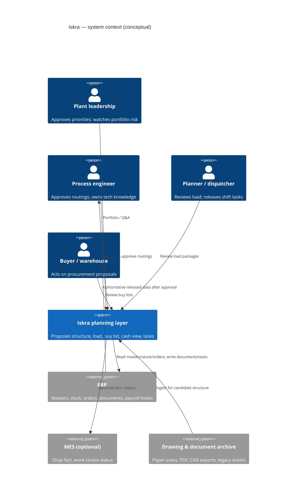
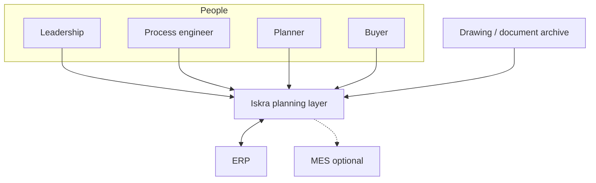
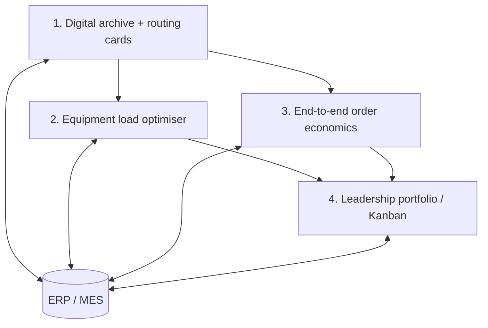
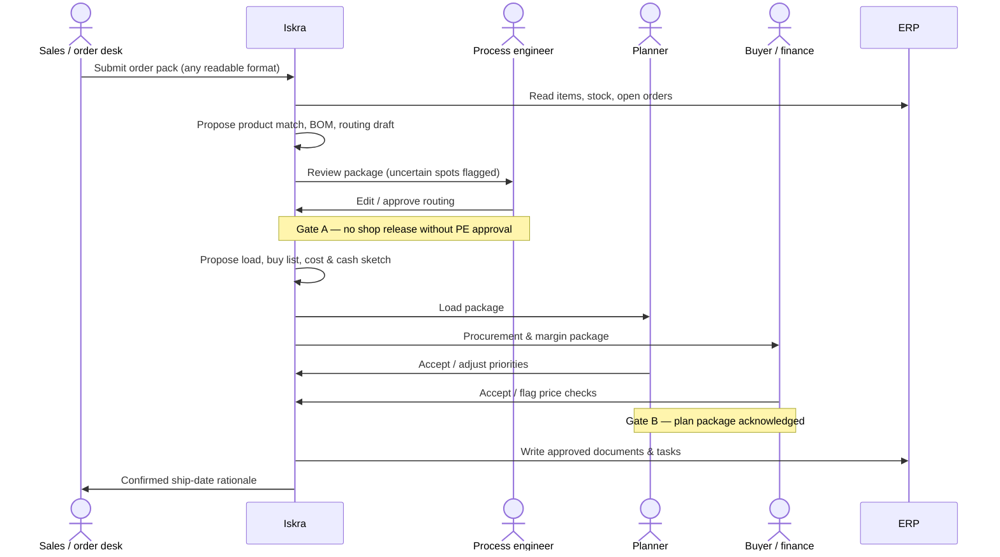

# Architecture

Public overview for CTOs and IT auditors. Implementation details of models, solvers, parsers, and ERP connectors are **out of scope** for this repository.

## System context

If Mermaid C4 rendering is unavailable in your viewer, the same idea:

**Design stance:** ERP remains the system of record. Iskra is a thinking and drafting layer with mandatory human gates.

## Logical components (ensemble)

| Component | Responsibility | Notes for auditors |
|-----------|----------------|--------------------|
| Ingest & normalisation | Accept heterogeneous documents; classify; prepare review packages | No claim of 100% auto-read on poor scans |
| Structure proposal | Candidate BOM lines and routing operations | Always reviewable; editable |
| Schedule optimisation | Feasible equipment/shift allocation under calendars and priorities | Deterministic optimisation layer; explainable vs. manual plan |
| Economics projection | Material need, cost/margin view, weekly cash sketch | Accuracy bounded by price/stock freshness |
| Portfolio & leadership UI | Kanban of stages, risk highlights, constrained answers | Answers only from contour + ERP-derived facts |
| Exchange bus | Read/write documents without rewriting ERP core | Pattern chosen per plant policy during engagement |

Deployment preference for sensitive data: **on-premises** processing for people/payroll-related fields; any external processing only under written data policy.

## Module view (four sellable modules)

### Module 1 — Digital archive + routing cards

- **In:** drawings and tech docs (scan/PDF/CAD export/legacy sheets), item context from ERP.
- **Out:** candidate BOM + routing card; list of uncertain spots; load into ERP **after approval**.
- **Not in box:** full historical archive cleanup beyond pilot volume; exotic process rules; non-ERP PLM deep integration.

### Module 2 — Equipment load optimiser

- **In:** approved routings, order portfolio, equipment calendars, changeover/repair windows (as provided).
- **Out:** shift assignments, bottleneck forecast, planner/master views.
- **Not in box:** creating routings; deep SCADA; physics simulation of processes.

### Module 3 — End-to-end order economics

- **In:** order + approved structure; stock; supplier lead times/prices as available.
- **Out:** buy recommendations, cost/margin view, weekly cash sketch, low-margin signals.
- **Not in box:** placing POs; full enterprise MRP II; FX forecasting.

### Module 4 — Leadership portfolio / Kanban

- **In:** order stage statuses, risks from upstream modules, KPI feeds.
- **Out:** one-screen portfolio, automatic risk highlight, short answers to typed questions on **existing** data.
- **Not in box:** full BI suite; replacement of ERP financial reports.

## Sequence of a planning run (with approval gates)

## Security and audit posture (public)

- Prefer plant-perimeter processing for personal and payroll-related data.
- All consequential outputs are **proposals** until a named role approves.
- Contour Q&A must refuse to fabricate missing operational facts.
- This showcase contains **no** credentials, connectors, or live endpoints.

## Related documents

- [data-model.md](data-model.md) — schemas and field intent  
- [case-reference-plant.md](case-reference-plant.md) — reference model and labelled estimates  
